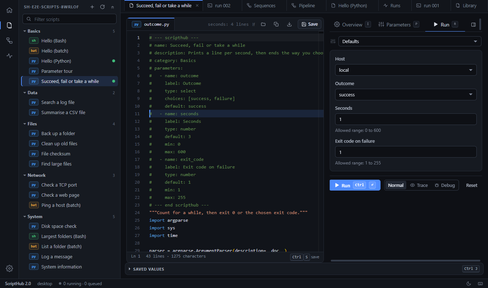

# ScriptHub (Electron)

[](https://github.com/Picassodiamond/ScriptHub-Electron/actions/workflows/ci.yml)
[](LICENSE)



Discover, configure, run and monitor Python / Bash / batch scripts, locally or on remote Linux hosts over `ssh`. This is
the desktop rewrite of the Django app: the same features and the same data, as an Electron app with a TypeScript engine.
There is no server, no port and no login: the window talks to the engine in the main process over IPC.

## Architecture

```
packages/
  engine/      headless: all the logic. No Electron, no DOM, no UI. Node built-ins and pure-JS dependencies only.
  protocol/    the contract between UI and engine: every call (name, zod arguments, result type), every event.
  client/      what the UI uses: typed `api`, event hub, the transport interface, and the demo / mock transports.
  ui/          Preact workbench: shell (menus, tabs, side panels, status bar) and one panel per page kind.
apps/
  electron/    main process, preload bridge, tray, native menu and dialogs, packaging.
samples/       sample scripts and sample projects (shipped with the app).
tools/         build helpers (sample projects).
```

Dependencies only point downwards: `electron → engine, protocol`; `ui → client → protocol`; `engine → protocol`.
The UI never imports the engine, and the engine knows nothing about a window.

**Engine** (`packages/engine/src`). A port of the Django app's modules, one for one: `yamlish`, `metadata`, `parameters`,
`discovery`, `workspace`, `executor`, `processManager`, `tracing` (line tracing and the step debugger), `history`,
`presets`, `sequences`, `sequenceRunner`, `projectFiles`, `newScript`, `scriptEditor`, `backups`, `runtimeData`.
`Engine` wires them for one data folder; `HostServices` (dialogs, notifications, reveal) is the only thing the host
provides. `src/api/` implements every protocol call on top of the Engine (`registerHandlers`) and turns polling into
pushed events (`run.output`, `run.status`, `debug.state`, `sequence.status`, `scan.progress`, `runs.changed`).

**Protocol.** One declaration per call in `protocol/src/calls.ts`; arguments are validated with zod on the engine side,
results are plain JSON (no class instances). The UI imports the zod-free `web.ts` entry, so the bundle stays small.

**UI.** `core/` (tabs, layout, commands, hotkeys, hooks, toasts, dialogs), `shell/` (the chrome) and `panels/<kind>/`
(the pages). A panel registers itself with `registerPanel(kind, Component)`; see `packages/ui/README.md` for the panel
contract (props, params between pages, the close guard, hooks). The editor is behind an `EditorAdapter` interface
(Monaco here).

**Electron** (`apps/electron`). Sandboxed renderer (`contextIsolation`, no Node, strict CSP, `app://` protocol), a
preload that exposes only `window.scripthub = { request, subscribe }`, single-instance lock, tray (closing the window
keeps running jobs alive), native menu, native dialogs (`host.*` calls: open / save project, save file, data folder).

## Run, test, build

```powershell
npm install
npm run dev          # Electron with hot reload (SCRIPTHUB_HOME=<folder> uses another data folder)
npm run dev:ui       # the UI alone in a browser, with the engine's real answers for the samples (no engine needed)
npm test             # engine tests (real python / bash subprocesses, throwaway data folders)
npm run test:ui      # component tests (jsdom + Preact, mock transport)
npm run typecheck    # all packages
npm run build        # renderer + main process
npm run pack         # unpacked Windows app in dist/win-unpacked (smoke-test it with npm run smoke)
npm run dist         # NSIS installer + portable build
```

Regenerating generated files:

```powershell
# the browser demo data (packages/client/src/demoData.json), from the sample scripts
$env:SCRIPTHUB_REBUILD_DEMO=1; npx vitest run packages/engine/test/demoFixtures.test.ts
# the sample projects (samples/sample_projects/*.scripthub) after changing a sample script
$env:SCRIPTHUB_REBUILD_SAMPLES=1; npx vitest run packages/engine/test/sampleScripts.test.ts
```

## Compatibility with the Django app

The data folder (`runtime/`) has the same layout and file formats, so both apps can use the same folder:
`config.json`, `workspace.json`, `executions/RUN-*/`, `presets/`, `sequences/*.yaml`, `sequence_runs/SEQ-*/`,
`backups/`, `script_ids.json`. Script metadata is the same YAML block inside the script (older JSON blocks and
`<stem>.json` sidecars are still read), script ids and aliases are computed the same way, and `.scripthub` project
files are interchangeable (the tests open the Python-built sample projects). The data folder is `SCRIPTHUB_HOME`, else a
`runtime` folder next to the app (portable), else the user data folder (`%LOCALAPPDATA%\ScriptHub`, ...).

Like the Django app there is no authentication: it is a single-user tool, and the scripts it runs are arbitrary code.
Execution never goes through a shell (argument lists locally; `shlex`-quoted commands over SSH).

## Planned: a VS Code extension

The split is made for it. The extension would run the same `Engine` in its extension host (it needs no native modules),
use the same protocol over `postMessage` for webviews (a second `Transport` next to the Electron one), show the same
panels (`packages/ui`) in webviews with the theme variables mapped to VS Code's, and replace the parts the shell owns by
native VS Code UI: a tree view for scripts and sequences, commands for the menus, a status bar item, and the native
editor behind `EditorAdapter`. Desktop-only pieces (tray, native menu, window state) stay in `apps/electron` behind
`HostServices`.

## Contributing, security, license

See [CONTRIBUTING.md](CONTRIBUTING.md) and [SECURITY.md](SECURITY.md). Released under the [MIT License](LICENSE).
The original Django version lives at <https://github.com/Picassodiamond/ScriptHub>.
